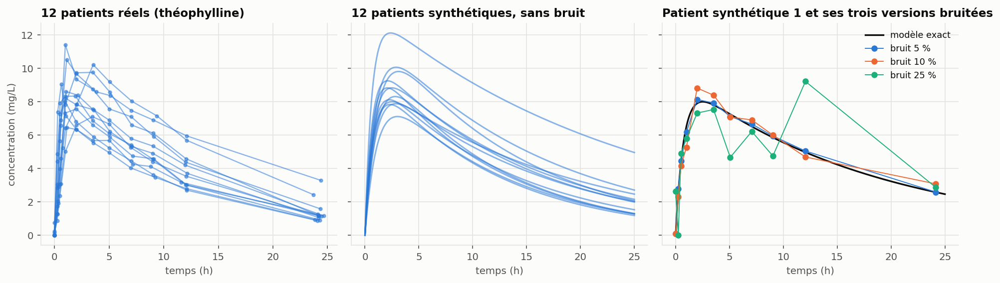
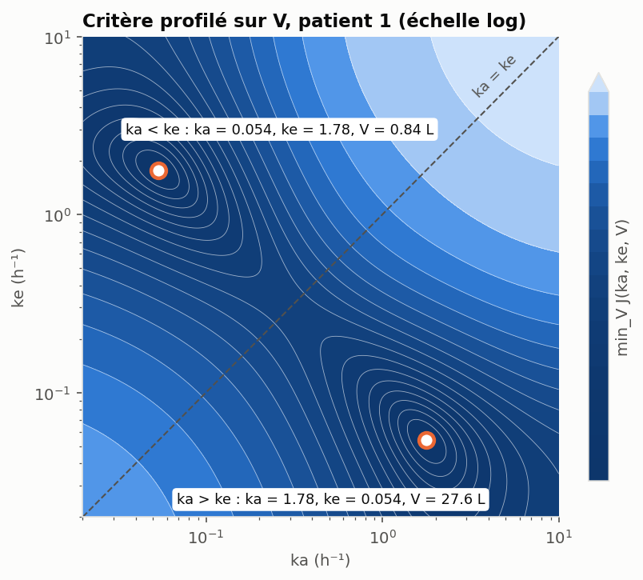
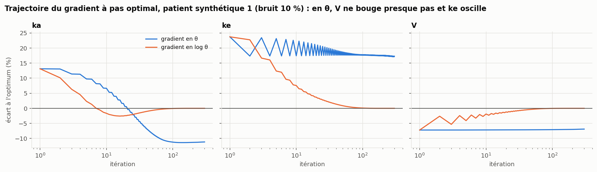
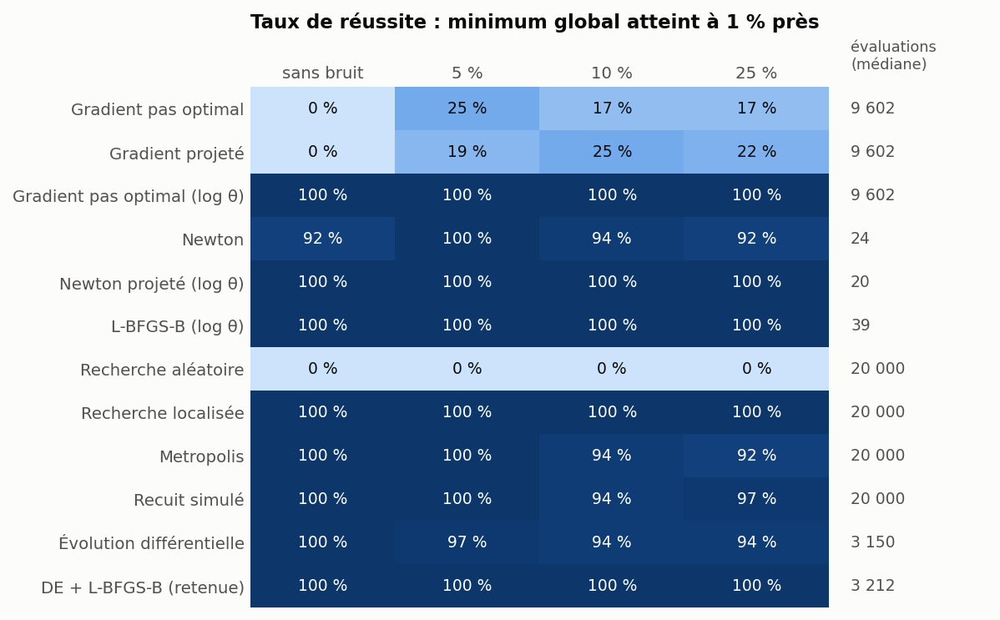
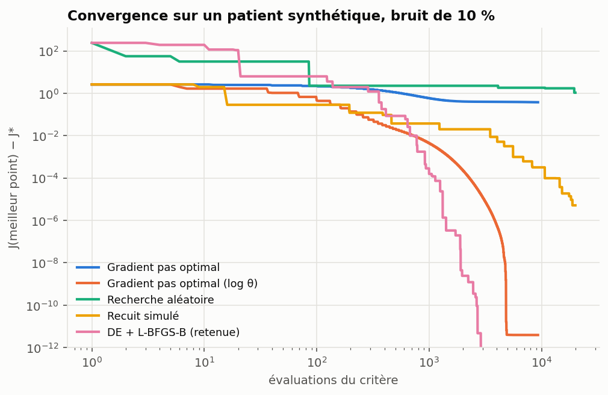
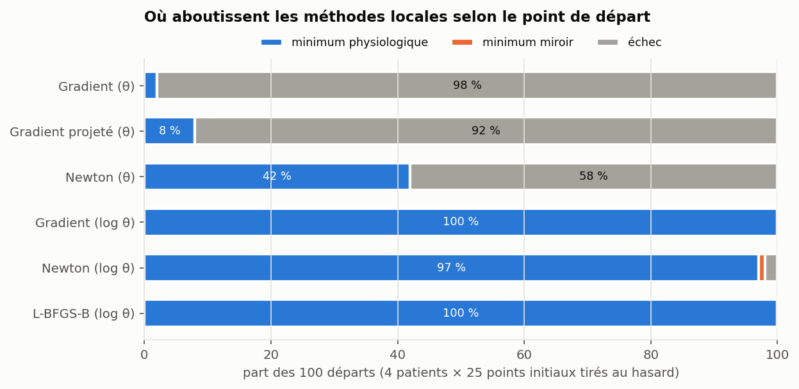
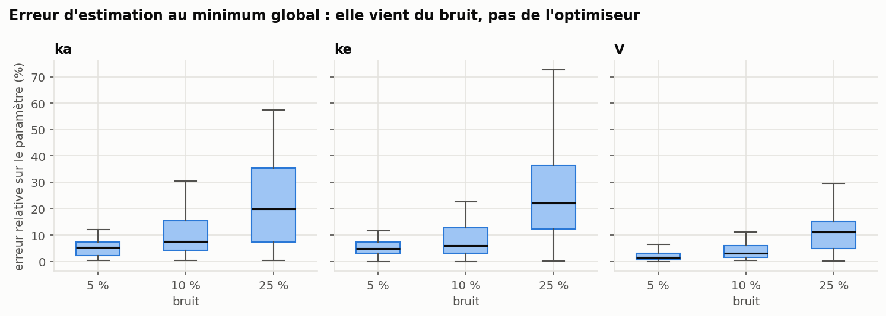
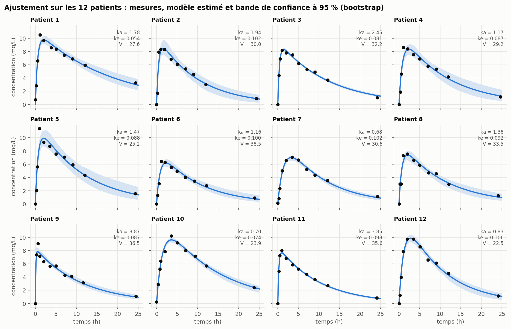
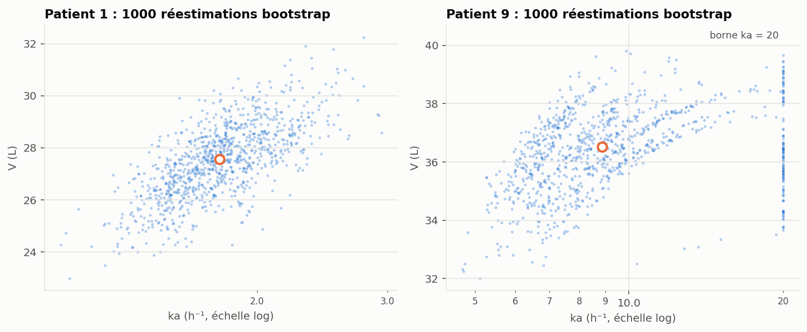
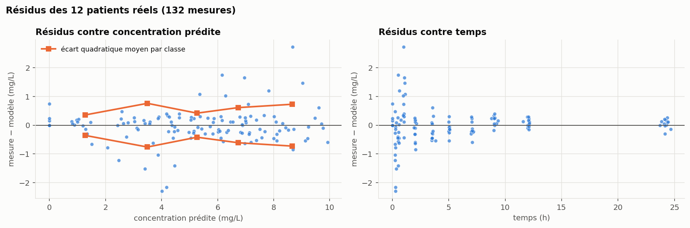

# Estimer les paramètres pharmacocinétiques de la théophylline par optimisation

Projet d'optimisation numérique : retrouver, à partir de 11 prises de sang, la vitesse d'absorption (ka),
la vitesse d'élimination (ke) et le volume de distribution (V) d'un médicament, puis comparer douze
méthodes d'optimisation, déterministes et stochastiques, sur ce problème.

Le [notebook](notebooks/analyse.ipynb) présente les résultats. Le calcul se trouve dans le package
[`pkopt`](src/pkopt/) et dans les [scripts](scripts/).

## Le point de départ

Après la prise orale de 300 mg de théophylline, la concentration dans le sang suit un modèle à un compartiment :

```
U(t) = D·ka / (V·(ka − ke)) · (e^(−ke·t) − e^(−ka·t))
```

On cherche (ka, ke, V) qui minimise l'écart quadratique J entre ce modèle et les mesures.
Le problème paraît simple (trois paramètres), mais il cumule trois difficultés : le critère n'est pas convexe,
les paramètres ont des ordres de grandeur très différents (ke ≈ 0,1 h⁻¹, V ≈ 30 L) et certains patients
n'ont presque aucune mesure pendant la phase d'absorption.

Les données : 12 patients réels (étude théophylline), 12 patients synthétiques dont je connais les vrais
paramètres, que je bruite à 5, 10 et 25 %, et les 12 patients synthétiques fournis en annexe du sujet.

<p align="center"></p>

La première version de ce travail était un notebook de cours. En la reprenant, j'ai trouvé que plusieurs
conclusions venaient d'artefacts et non du problème lui-même (voir [plus bas](#ce-qui-a-changé-par-rapport-à-la-première-version)).
Ce dépôt en est la version corrigée et vérifiée.

## Ce que contient le projet

- Le modèle, avec son gradient et sa hessienne analytiques, écrits sous une forme stable qui n'a plus de cas
  particulier quand ka = ke. Ils sont vérifiés contre les différences finies et contre la résolution numérique de l'EDO.
- Les méthodes déterministes : section dorée, gradient à pas fixe et à pas optimal, Newton amorti, et leurs
  versions projetées sur un pavé de contraintes.
- Les méthodes stochastiques : recherche aléatoire, recherche localisée, Metropolis et recuit simulé, toutes
  reproductibles (graine fixée) et lancées avec le même budget de 20 000 évaluations.
- La stratégie retenue : évolution différentielle (recherche globale), puis L-BFGS-B (affinage), en log θ.
- Un benchmark sur 120 jeux de données synthétiques (12 patients, 4 niveaux de bruit, 3 tirages du bruit). Il
  distingue l'échec de l'optimiseur de l'erreur due au bruit.
- L'estimation sur les 12 patients réels, avec intervalles de confiance (linéarisation et bootstrap des résidus).

## Résultats

**1. La non-convexité a une cause précise.** Échanger ka et ke en remplaçant V par V·ke/ka donne exactement
la même courbe (phénomène de *flip-flop*). Le critère a donc toujours deux minima globaux de même valeur.
On retient celui où ka > ke, l'absorption d'un comprimé étant plus rapide que l'élimination.

<p align="center"></p>

**2. Le gradient n'était pas piégé : le problème était mal conditionné.** En paramètres naturels, le
conditionnement de la hessienne au minimum vaut entre 5·10⁴ et 2·10⁵ selon le patient. Il tombe entre 36 et 164
en travaillant sur log θ. Concrètement, la composante du gradient sur V est environ 70 fois plus faible que
celle sur ke : en θ, V ne bouge presque pas et ke oscille d'une itération à l'autre.

<p align="center"></p>

Le même gradient à pas optimal passe alors de 0 à 25 % de réussite à 100 %. Newton et L-BFGS-B en log θ
atteignent le minimum global dans 100 % des cas, en 20 à 40 évaluations du critère. Les méthodes stochastiques
en demandent 20 000. La recherche aléatoire pure ne l'atteint jamais à 1 % près.

<p align="center">
  
  
</p>

Le changement de variable rend aussi les méthodes locales insensibles au point de départ. Sur 100 départs tirés
au hasard, le gradient en θ n'atteint le minimum que 2 fois, Newton en θ 42 fois, et les trois méthodes en
log θ au moins 97 fois. Newton tombe une fois sur la solution miroir, ce qui reste une solution exacte.

<p align="center"></p>

Côté méthodes stochastiques, le recuit simulé atteint le minimum quelle que soit sa température initiale, même
très basse. Une fois la solution miroir exclue par les bornes, le paysage n'a plus qu'une vallée : le recuit
se comporte alors comme une recherche locale, ce qui explique aussi les 100 % de la recherche localisée.
La recherche aléatoire, elle, reste à 3 % du minimum même avec un million d'évaluations
([figure](figures/11_hyperparametres.png)).

**3. Au-delà de l'optimiseur, c'est le bruit qui limite la précision.** Au minimum global, l'erreur médiane
avec 10 % de bruit est de 7,5 % sur ka, 6,1 % sur ke et 3,1 % sur V. Avec 25 % de bruit, elle dépasse 20 %
sur ka et ke. Aucune méthode d'optimisation ne peut faire mieux, puisqu'elles trouvent toutes le même point.
Contrairement à ce que concluait la première version, V est le paramètre le mieux déterminé.

<p align="center"></p>

Le nuage des estimations contre les vrais paramètres montre la même chose : à 5 % de bruit, les points
restent sur la diagonale ; à 25 %, ka et ke peuvent s'en écarter du simple au double
([figure](figures/12_estime_vs_vrai.png)).

**4. Sur les vrais patients**, le modèle explique entre 89 % et 99 % de la variance des mesures (R²).
La stratégie retrouve les estimations de `scipy.optimize.curve_fit` à 2·10⁻⁵ près. Les moyennes géométriques
(ka = 1,61 h⁻¹, ke = 0,088 h⁻¹, V = 30,0 L) sont proches des valeurs de population habituellement citées pour
ce jeu de données (1,5 h⁻¹, 0,086 h⁻¹ et 32 L).

<p align="center"></p>

Le patient 9 atteint son pic avant le deuxième prélèvement : les données indiquent seulement que l'absorption
est rapide. On estime ka = 8,9 h⁻¹, avec un intervalle de confiance à 95 % de [3,2 ; 24], et une partie des
réestimations bootstrap bute sur la borne ka = 20. Son volume V reste pourtant déterminé à ±11 % près.

<p align="center"></p>

Les résidus montrent la principale limite du modèle. Leur écart quadratique moyen vaut 0,93 mg/L pendant
l'absorption (prélèvements entre 0 et 2,5 h), contre 0,26 mg/L ensuite. Une absorption d'ordre 1 qui démarre
dès la prise décrit mal les premières heures. Un temps de latence, ou une absorption d'ordre 0, serait la
première extension à tester.

<p align="center"></p>

**5. Second cas d'étude : les données synthétiques de l'annexe du sujet.** Ces 12 patients ont été simulés,
puis bruités, et leurs vrais paramètres ne sont pas communiqués. La même stratégie les ajuste avec un R²
compris entre 0,986 et 0,999 ([figure](figures/07_ajustements_annexe.png)). Plusieurs prélèvements y tombent
pendant la phase d'absorption, si bien que ka est mieux déterminé que chez les vrais patients : son intervalle
à 95 % va de ±8 % à ±25 % selon le patient.

Le détail chiffré est dans [`resultats/`](resultats/) : [benchmark](resultats/benchmark_resume.md),
[patients réels](resultats/donnees_reelles.csv), [annexe](resultats/donnees_annexe.csv),
[conditionnement](resultats/conditionnement.csv), [points initiaux](resultats/points_initiaux.csv),
[réglages des méthodes stochastiques](resultats/hyperparametres.csv).

## Ce qui a changé par rapport à la première version

| Constat dans la version de cours | Ce qui se passait vraiment |
|---|---|
| « Le gradient à pas optimal reste à ~14 % d'erreur, piégé dans un minimum local » | Mauvais conditionnement : l'algorithme bougeait à peine depuis le point de départ, d'où une erreur identique à tous les niveaux de bruit. En log θ, il converge à chaque fois. |
| « V est toujours le paramètre le plus difficile » | L'erreur était mesurée par ‖θ̂ − θ‖ / ‖θ‖, une norme dominée par V (≈ 30) face à ke (≈ 0,1). Mesurée paramètre par paramètre, l'erreur sur V est la plus faible. |
| « L-BFGS-B et l'évolution différentielle sont devenues indépendantes avec `polish=False` » | Elles donnaient toujours les mêmes chiffres, simplement parce qu'elles trouvent toutes les deux le minimum global. Ce n'était pas un défaut. |
| Patient 9 : ka = 5,0 | C'était la borne supérieure du pavé de recherche. Avec des bornes plus larges, ka = 8,9. |
| Référence `curve_fit(method='tls')` | Cette méthode n'existe pas dans scipy. L'erreur était interceptée, et le code basculait sans le dire sur Levenberg-Marquardt sans bornes. |
| ∂U/∂ka dans le cas ka = ke | La formule donnait (1 − k²) au lieu de (1 − k·t/2). Un test vérifie maintenant toutes les dérivées. |
| Méthodes stochastiques avec `np.random.seed(None)` et des budgets différents | Résultats non reproductibles et comparaison inéquitable. Chaque méthode reçoit maintenant sa graine et le même budget. |

## Organisation

```
src/pkopt/
  modele.py            concentration, jacobienne, hessienne, symétrie flip-flop
  objectif.py          critère J, gradient, hessienne, passage en log θ
  deterministes.py     section dorée, gradient (fixe/optimal), Newton, versions projetées
  stochastiques.py     recherche aléatoire et localisée, Metropolis, recuit simulé
  strategie.py         évolution différentielle + L-BFGS-B
  incertitude.py       intervalles par linéarisation, bootstrap des résidus
  donnees.py           patients réels, patients synthétiques, bruit
scripts/
  paysage.py           critère profilé et conditionnement (figure 01)
  benchmark.py         12 méthodes × 120 jeux de données → resultats/benchmark.csv
  figures_benchmark.py figures 02 à 04 et tableau récapitulatif
  donnees_reelles.py   estimation et incertitude sur les 12 patients (figures 05 et 06)
  donnees_annexe.py    second cas d'étude, données de l'annexe (figure 07)
  figures_complementaires.py  données, trajectoires, points de départ, réglages, résidus (figures 08 à 13)
notebooks/analyse.ipynb  présentation des résultats
tests/                 dérivées, EDO, flip-flop, données, convergence des algorithmes
data/
  theophylline.csv          les 12 patients réels (132 mesures)
  synthetiques_annexe.csv   les 12 patients synthétiques de l'annexe du sujet
```

## Lancer le projet

```bash
pip install -r requirements.txt
make            # tests, benchmark, toutes les figures et le notebook (environ 15 minutes)
```

Sans `make` (sous Windows par exemple), lancer dans l'ordre :

```bash
python -m pytest -q
python scripts/paysage.py
python scripts/benchmark.py
python scripts/figures_benchmark.py
python scripts/donnees_reelles.py
python scripts/donnees_annexe.py
python scripts/figures_complementaires.py
```

Toutes les graines aléatoires sont fixées, donc deux exécutions donnent les mêmes résultats.

## Données

Le jeu de données `Theoph` est distribué avec R (package `datasets`). Il vient de l'étude publiée dans
Boeckmann, Sheiner et Beal (1994), *NONMEM Users Guide, Part V*. Il contient 12 sujets, une dose orale
de théophylline et 11 prélèvements sur 24 heures par sujet. Le fichier `data/theophylline.csv` en est
l'export direct. Il comprend le poids et la dose réelle de chaque patient (de 268 à 321 mg), alors que
l'énoncé du projet fixe 300 mg pour tous.

Le fichier `data/synthetiques_annexe.csv` reprend les 12 patients synthétiques fournis en annexe du sujet
du projet, avec une dose de 300 mg et les mêmes instants de prélèvement.
